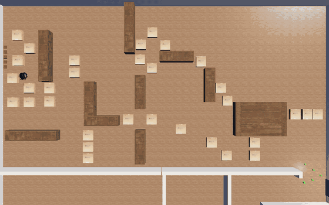

## Quick Summary

An autonomous mobile robot built in Webots that uses computer vision, a compass and hand-tuned waypoint routes to navigate a 20×20 meter warehouse, locate honey jars, collect them, and place them in designated storage areas—all without human intervention.

I later came back to the project and rewrote the controller as **v2**, keeping the original **v1** unchanged next to it so the two can be compared directly.

**Tech Stack:** Webots R2025a, Java, Computer Vision, Robotics, JUnit  
**Status:** ✅ v1 complete; ✅ v2 rewritten, tested, and run in Webots: 30 of 30 jars delivered across six shuffled worlds (v1: 0 of 30)  
**GitHub:** [View Source Code](https://github.com/morganwhite13/Autonomous-Robot-Jar-Collection-System)

---

## Video Demo

<iframe src="https://www.youtube.com/embed/kO9e8dzjCfg" title="Autonomous Robot Jar Collection Demo" loading="lazy" allow="accelerometer; autoplay; clipboard-write; encrypted-media; gyroscope; picture-in-picture" allowfullscreen></iframe>

The video shows the original controller.

---

## Before and After: the v2 Rewrite

v2 keeps v1's mission, gripper timing and vision thresholds, and changes how the robot moves, carries jars and recovers when something goes wrong. Both versions ran the whole mission in Webots, on the same world and robot, judged by the same observer, and then on six shuffled worlds with the jars moved around. Both were also measured on a fast model of the robot:

{: .chart .chart-wide width="1200" height="395" loading="lazy" decoding="async"}

| Situation | v1 (original) | v2 (rewrite) |
|---|---|---|
| **Whole mission in Webots** (real physics) | **0 of 5 jars delivered**, while counting 4 as delivered; stuck against a wall from 1204 s | **All 5 delivered in 738 s** (12.3 min), no stalls or failed searches |
| **Six shuffled Webots worlds** (jars moved, start nudged) | **0 of 30 jars**, while counting 22; stuck for good in 5 of 6 | **30 of 30**, every world finished in 721-765 s |
| Whole mission on the robot model (20 variants of motor lag and wheel slip) | Never finishes (at most 2 of 5 jars delivered) | Delivers all 5 jars every time |
| After a failed search for jars 2-5 | Drives a 17.8 m straight line through 4 immovable boxes | Returns 0.8 m to the search point |
| Something in the way | Pushes forever | Stops short on the sonars (or notices the stall in about 4 s), then plans a way around it with A* |
| "360°" jar scan | Turns about 271° (fixed time) | Turns a full circle, measured by the compass |
| Finding jars 2-5 | A full scan for every jar | Remembers where it saw them: 2-3 scans in a whole mission |
| A far jar split between two thirds of the camera image | Stands still to "reassess" until the approach gives up | Steers towards the side with more green |
| End of a 530 cm leg started 2.9° off | 26.8 cm from the waypoint | 1.1 cm |
| No jar can be found | Retries forever | Stops after 3 attempts with a mission report |
| Carrying a jar | Turns at full speed with the jar 5 cm up, so it flies or slips out in Webots, and still counts the delivery | Turns gently with the jar 0.8 cm up, checks the grip, and notices within about a second if the jar falls out |
| Tests and CI | None | 181 JUnit tests covering 99% of v2's logic and catching 91% of injected bugs (mutation testing); static analysis; GitHub Actions, including v2's whole mission in Webots |

Here are both versions in Webots, replayed at 30x speed from the recorded runs. v1 (orange) aims at the floor and walls: its green test counts them as jar-coloured. It makes four trips to the drop-off with an empty gripper, then ends up pressed against a wall at the far end of the jar bay. v2 (blue) makes five round trips and delivers every jar in 738 s:

{: .chart .chart-wide width="2020" height="1500" loading="lazy" decoding="async"}

And v2 seen from above in Webots, pushing the boxes aside and then fetching the jars one at a time:

{: .chart .chart-wide width="560" height="350" loading="lazy" decoding="async"}

One world can be lucky, so both versions also ran on six shuffled worlds, with the jars placed at random in the jar bay and the robot's start pose nudged. v1 delivered none of the 30 jars. v2 delivered all 30. Those runs found three more problems that the original world never showed, all fixed in v2 (see the challenges below).

On the robot model, at 30x speed with motor lag and wheel slip added, v1 drifts off its route while clearing boxes, drives into a wooden box and keeps pushing; v2 delivers all five jars:

{: .chart .chart-wide width="2020" height="1500" loading="lazy" decoding="async"}

The robot model files were never committed with the original project, so the Webots runs use Cyberbotics' own Pioneer 3-DX models, reconstructed. The video shows jars being collected, so the original setup may have suited v1 better than this one does. The full write-up, with each fix and the original line numbers, is in the [repository's pull request](https://github.com/morganwhite13/Autonomous-Robot-Jar-Collection-System/pull/2).

---

## The Challenge

Design and implement a fully autonomous robot system that can:
- Navigate a warehouse full of walls, immovable wooden boxes and pushable cardboard boxes
- Detect and locate small objects with an onboard camera
- Manipulate objects with a gripper system
- Return collected items to a designated drop-off zone
- Repeat this process for multiple objects

Jar detection and grasping rely on the robot's own camera and touch sensor. To move between the search area and the drop-off zone, the controller follows hand-tuned waypoint routes, using the compass and the robot's exact position from the simulator (the controller runs as a Webots Supervisor).

---

## System Architecture

### Hardware Configuration

The robot is built on a Pioneer 3-DX platform equipped with:

**Sensors:**
- 64×64 RGB camera, 45° field of view, for colour-based jar detection
- Compass for heading
- Touch sensor (front bumper) to know when a jar is between the gripper fingers
- 6 ultrasonic distance sensors (enabled and logged for debugging; not used in control)

**Actuators:**
- Differential drive motors (left & right wheels)
- Gripper lift motor
- Gripper finger motors (left & right)

**Key Specs:**
- Max wheel speed: 5 rad/s (about 0.49 m/s)
- Arena: 20 m × 20 m
- Jars: 5, each with its own drop-off pad
- Obstacles: 32 pushable cardboard boxes, 10 immovable wooden boxes and the walls

---

## How It Works

### 1. Colour-Based Jar Detection

The camera image is split into left, centre and right thirds (21 / 22 / 21 columns), and the controller counts jar-green pixels in each:

- A pixel counts as green when R < 120, G > 35 and B < 120. v2 also requires green to be the strongest channel, so grey and brown pixels no longer count.
- **Search:** the robot turns on the spot and scores each frame by its green pixels, with a bonus when they're in the centre third, then turns to the best heading.
- **Approach:** it creeps forward, steering towards whichever third leads the others by more than 10 pixels, until the front bumper is pressed. v2 goes faster while the jar is far away, and steers towards the side with more green when no third clearly leads.
- **Jar map (v2):** from how low in the image a jar reaches, and which column it's in, v2 works out where each jar is, using the camera's measured height and focal length. Later searches head straight for a mapped jar instead of scanning again.

### 2. Waypoint Navigation

The mission runs in phases. v1 uses hand-tuned waypoints; v2 carries and returns on A*-planned routes about 14% shorter:

- **Clearing:** a 15-waypoint route pushes cardboard boxes out of the way and ends at the search point.
- **Search and grab:** scan, approach, close the gripper, lift.
- **Carry:** a 10-waypoint route to the drop-off lane.
- **Place:** line up with that jar's pad, release, back out, and go back for the next jar.

Each leg turns on the spot towards the next waypoint, then drives to it. v1 turns at full speed until within ±3° and drives without steering. v2 slows down as it nears the target heading, works correctly across the 0°/360° boundary, and steers towards the waypoint while driving. When something stops it, whether it's seen by the front sonars or noticed as a stall, v2 backs off and plans a way around it with A*.

---

## Results

| Metric | Value |
|--------|-------|
| Jars collected (original runs) | 5/5 |
| Total mission time (original runs) | About 13-15 minutes |
| Control loop | One 32 ms simulation step (about 31 Hz) |
| Turn tolerance | ±3° |
| v1 in Webots, reconstructed robot | 0/5 jars delivered (4 claimed); 0/30 on six shuffled worlds |
| v2 in Webots, reconstructed robot | 5/5 jars in 738 s; 30/30 on six shuffled worlds (721-765 s) |
| v2 on the robot model | 5/5 jars, no stalls, including with motor lag and wheel slip |

---

## Challenges & Solutions

### Challenge: A Failed Search Could Strand the Robot

**Problem:** In v1, if the robot failed to find jars 2-5 it took the "return from drop-off" route even though it was still at the search point. That route's first leg is a straight line across the arena through four immovable wooden boxes, and with no stall detection the robot could push against one forever.

**Solution:** v2 tracks where the robot is and takes the short route back to the search point. After 3 failed searches in a row it stops and reports what it achieved.

---

### Challenge: Turning and Driving Precisely

**Problem:** At full speed one 32 ms step turns the robot about 5°, so it could jump over the ±3° target window and swing back and forth. Driving without steering, a heading error inside that tolerance became about 27 cm of sideways error over the longest leg.

**Solution:** v2 slows the turn as it nears the target and steers towards the waypoint while driving. On the model, every turn finishes and the long leg ends within about 1 cm.

---

### Challenge: Gripper Synchronization

**Problem:** Premature gripper opening could drop collected jars

**Solution:** Timed sequences give the motors time to reach their positions: close the fingers for 100 steps, lift for 120, hold for 20 before driving off.

**Result:** No jar drops in the original runs

---

### Challenge: Carrying a Jar Through Real Physics

**Problem:** v2's first Webots runs grabbed every jar and still delivered none. A supervisor script that logged the jar's position showed why. The grab was solid, with the fingers squeezing at their limit and the jar lifted upright. But the first full-speed turn towards the drop-off threw it out of the gripper within 0.6 seconds. v1 turns the same way.

**Solution:** v2 turns at a third of full speed while it's carrying a jar, which keeps the jar through turns, full-speed driving and hard stops. With that change it delivered all five in the original world.

**Then the shuffled worlds:** on six worlds with the jars moved around, v2 still lost 8 of 30 jars on the way, while counting all 30 as delivered. Testing showed jars lifted 5 cm slipped out on hard stops, while jars carried 0.8 cm up stayed in every time. v2 now carries jars low. It also watches the finger force: fingers holding a jar push at their limit, so when the force stays low for a second, the jar has gone. v2 then goes back to fetch it instead of driving on empty-handed.

---

### Challenge: An Approach That Froze

**Problem:** On one shuffled world every approach to the last jar stopped dead, 1.7 m away. Overhead camera frames showed nothing in the way. The jar was small and far, 5 green pixels in the centre third of the image and 15 in the right one. v1's steering rule needs a clear 10-pixel lead or 30 pixels in all, so the robot stopped to "reassess". Standing still, it saw exactly the same picture and stopped again.

**Solution:** when the jar is in sight but no third clearly leads, v2 steers towards the side with more green. That world went from 4 of 5 jars to 5 of 5, each jar grabbed on the first approach.

---

### Challenge: Testing a Robot Without the Simulator

**Problem:** Webots is slow to iterate with, and the original controller called the Webots API from every method, so none of it could be tested on its own.

**Solution:** v2 puts all Webots access behind one interface. The mission logic runs unchanged against a kinematic model of the robot with a synthetic camera, and line-for-line ports of v1's methods run on the same model, so both versions can be measured the same way.

---

## Code Architecture

**v1:** one file, `ProjectController3.java` (765 lines), with every method `static`: `intelligentJarSearch`, `rotateAndFindGreen`, `carefullyApproachGreen`, `executeGrab`, `makeHardcodedTurn`, `moveHardcodedAhead` and the route methods.

**v2:** 15 classes and one interface, each with one job:

| Class | Responsibility |
|---|---|
| `Mission` | The phase sequence, where the robot is, retry limit |
| `Navigator` | Turning, driving, stall detection, sonar watch, detours |
| `RoutePlanner`, `ArenaMap` | A* on a 5 cm grid, around the walls and wooden boxes |
| `JarHandler` | Scan and jar map, approach, grab and grip checks, place |
| `Vision` | Pixel classification, sector counts, steering decision, distance from the image |
| `Routes`, `Config` | Every waypoint and tunable number, defined once |
| `RobotPlatform` / `WebotsPlatform` | The robot interface and its Webots implementation (the only class that touches Webots) |
| `MissionStats`, `Log` | Simulated-time logging and an end-of-run mission report |

---|---|
| `Mission` | The phase sequence, where the robot is, retry limit |
| `Navigator` | Turning, driving, stall detection |
| `JarHandler` | Scan, approach, grab, place |
| `Vision` | Pixel classification, sector counts, steering decision |
| `Routes`, `Config` | Every waypoint and tunable number, defined once |
| `RobotPlatform` / `WebotsPlatform` | The robot interface and its Webots implementation (the only class that touches Webots) |
| `MissionStats`, `Log` | Simulated-time logging and an end-of-run mission report |

---

## What I Learned

This project taught me:

**Robotics Fundamentals**
- Sensor integration and fusion
- Motor control and feedback loops
- Path planning in constrained environments

**Computer Vision**
- Color space analysis (RGB thresholding)
- Spatial segmentation techniques
- Real-time image processing

**Real-Time Systems**
- Timing-critical operations
- Sensor synchronization
- Control loop optimization

**Problem-Solving**
- Debugging with limited feedback
- Handling sensor noise and ambiguity
- Iterative algorithm refinement

**Software Engineering**
- Large codebase organization, and later splitting it into focused classes
- API design and abstraction
- Testing control code without the simulator, and measuring old and new versions the same way

---

## Future Improvements

If I were to extend this project, I would:

1. **Low obstacles** - A 6 cm block is invisible to both the sonars and the camera. v2 drives around one that stops it, but one on the carry route can still catch the robot
2. **Driving without the simulator's position** - Both versions read the robot's exact position from Webots; odometry plus the compass, corrected at landmarks, would work on a real robot
3. **SLAM Implementation** - Add simultaneous localization and mapping for unknown environments
4. **Machine Learning** - Train CNN for robust object detection in variable lighting
5. **Multi-Robot Coordination** - Enable swarm behavior for collaborative collection
6. **Real Hardware Deployment** - Port to actual Pioneer 3-DX or mobile manipulator

---

## Files & Resources

**Project Files:**
- `worlds/ProjectWorld2025.wbt` - the Webots world (v1); `ProjectWorld2025_v2.wbt` is the same world running v2
- `controllers/ProjectController3/` - the original controller (v1)
- `controllers/JarCollectorV2/` - the rewritten controller (v2)
- `protos/` - the Pioneer 3-DX robot and gripper models
- `tests/`, `tools/` - unit tests, the robot model, benchmarks, and the Webots comparison and shuffled-world scripts

**Tools & Technologies:**
- Webots R2025a - Professional robotics simulator
- Java - Control system implementation
- JUnit 5, JaCoCo, PIT, SpotBugs, GitHub Actions - testing and CI
- Git - Version control

**How to Run:**
1. Install Webots R2025a from [https://cyberbotics.com](https://cyberbotics.com)
2. Build the controllers once with `tools/build-controllers.sh` (Webots doesn't compile Java controllers by itself)
3. Open `worlds/ProjectWorld2025.wbt` (v1) or `worlds/ProjectWorld2025_v2.wbt` (v2) in Webots
4. Press Play to start the simulation

---

## Takeaway

This project demonstrates end-to-end robotics development: from hardware design and sensor selection, through algorithm development and testing, to successful autonomous operation. Coming back to it later, I kept the original intact, measured its weaknesses, and fixed them in a tested rewrite. It showcases my ability to work with complex systems, solve real-time constraints, and improve a working system without losing track of what it did before.
