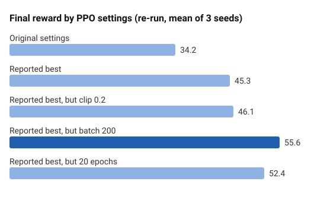
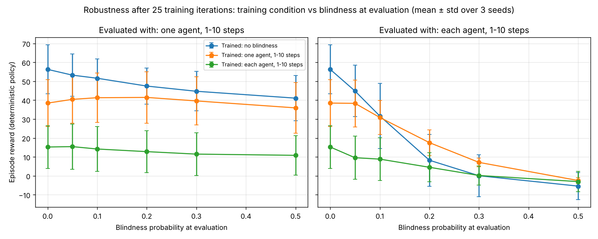

## Quick Summary

A Multi-Agent Reinforcement Learning research project investigating how swarm agents handle partial observability through random "blindness" events. Built custom blindness scenarios in VMAS (Vectorized Multi-Agent Simulator) where agents lose sensory input unpredictably, testing whether cooperative strategies can emerge despite information loss. Applied MAPPO (Multi-Agent Proximal Policy Optimization) with extensive hyperparameter tuning, then tested on separate evaluation episodes whether training with blindness makes the team more robust to it. It does, once trained long enough.

**Tech Stack:** Python, PyTorch, TorchRL, VMAS, MAPPO, Multi-Agent Deep RL  
**Status:** ✅ Complete - Course Capstone Project  
**GitHub:** [View Source Code](https://github.com/morganwhite13/Improving-MARL-Robustness-for-Agent-Blindness-in-VMAS)


---

## The Challenge

**The Real-World Problem:** Autonomous systems must cooperate even when sensors fail unexpectedly.

**Examples:**
- **Autonomous vehicles:** Camera systems malfunction mid-drive—must avoid collisions using limited data
- **Drone swarms:** GPS signal loss—drones must maintain formation without position data
- **Robot teams:** Sensor failures—robots must complete tasks despite missing observations
- **Satellite networks:** Communication blackouts—satellites must coordinate blindly

**The Research Question:** Can multi-agent reinforcement learning systems learn to cooperate robustly when agents randomly lose sensory input (go "blind")?

---

## System Architecture

### VMAS Framework Selection

**What is VMAS?**
- **V**ectorized **M**ulti-**A**gent **S**imulator
- GPU-accelerated physics simulator for MARL research
- Developed by Prorok Lab (University of Cambridge)
- Supports continuous control tasks with swarm-like behavior

**The Balance Scenario:**

The base environment features agents cooperating to roll a red ball to a green goal by collectively pushing a platform the ball rests on.

**Key Mechanics:**
- **Physics:** Realistic gravity, momentum, balance dynamics
- **Cooperation Required:** One agent can't succeed alone—must coordinate pushing
- **Swarm Behavior:** Parameter sharing across all agents (homogeneous policy)
- **Full Observability (baseline):** All agents see complete state

[View Balance Scenario GIF](https://github.com/matteobettini/vmas-media/raw/main/media/scenarios/balance.gif?raw=true)

### Custom Blindness Extension

**Core Innovation:** Random sensory deprivation during episodes

**Six Blindness Scenarios Implemented:**

**1. BlindOneRandomAgentEveryStep**
```python
class BlindOneRandomAgentEveryStep(Transform):
    def _step(self, tensordict, next_tensordict):
        # One random agent blinded every single step
        next_tensordict[("agents", "observation")][
            ..., random.randrange(self._n_agents), :
        ] = 0
        return next_tensordict
```

**2. BlindAllAgentsEveryStep**
- All agents simultaneously blinded every step
- Extreme difficulty baseline (near-impossible task)

**3. BlindOneRandomAgentIfProbability**
```python
class BlindOneRandomAgentIfProbability(Transform):
    def __init__(self, n_agents, blind_prob=0.1):
        self._blind_prob = blind_prob
    
    def _step(self, tensordict, next_tensordict):
        if random.random() < self._blind_prob:
            # 10% chance one agent goes blind for 1 step
            next_tensordict[("agents", "observation")][
                ..., random.randrange(self._n_agents), :
            ] = 0
        return next_tensordict
```

**4. BlindRandomAgentsIfProbability**
- Multiple agents can be blinded simultaneously
- Each agent has independent probability per step

**5. BlindOneRandomAgentIfProbabilityForJSteps**
```python
class BlindOneRandomAgentIfProbabilityForJSteps(Transform):
    def __init__(self, n_agents, blind_prob=0.1, max_blind_steps=10):
        self.blind_remaining = {i: 0 for i in range(n_agents)}
    
    def _step(self, tensordict, next_tensordict):
        for agent_idx in range(self._n_agents):
            if self.blind_remaining[agent_idx] > 0:
                # Agent still blind, decrement counter
                self.blind_remaining[agent_idx] -= 1
                next_tensordict[("agents", "observation")][
                    ..., agent_idx, :
                ] = 0
            elif random.random() < self._blind_prob:
                # New blindness event: 1-10 steps
                blind_duration = random.randint(1, self.max_blind_steps)
                self.blind_remaining[agent_idx] = blind_duration - 1
                next_tensordict[("agents", "observation")][
                    ..., agent_idx, :
                ] = 0
        return next_tensordict
```

**6. BlindRandomAgentsIfProbabilityForJSteps**
- Multiple agents can experience multi-step blindness simultaneously
- Most realistic scenario (models real sensor failures)

**Blindness Mechanism:**
- **Observation vector set to zeros** (agent receives no sensory input)
- **Actions still processed** (agent can move/act, just blindly)
- **Other agents unaffected** (only blinded agent loses vision)

---

## Algorithm Highlights

### 1. MAPPO (Multi-Agent Proximal Policy Optimization)

**Why MAPPO?**
- A strong, widely used baseline on cooperative MARL benchmarks (Yu et al., 2022, "The Surprising Effectiveness of PPO in Cooperative Multi-Agent Games")
- Competitive with off-policy methods such as MADDPG and QMIX in that study
- Stable training with centralized critic, decentralized execution
- Parameter sharing enables swarm-like behavior

**Architecture:**

```python
Policy Network (Decentralized Actor):
├── MultiAgentMLP
│   ├── Input: Agent observation (n_obs_per_agent)
│   ├── Hidden: 2 layers × 256 units (Tanh activation)
│   ├── Output: 2 × n_actions (mean & std for continuous actions)
│   └── Share parameters: True (all agents use same policy)
├── NormalParamExtractor (split output into loc & scale)
└── TanhNormal distribution (bounded continuous actions)

Critic Network (Centralized Value Function):
├── MultiAgentMLP
│   ├── Input: All agent observations (centralized)
│   ├── Hidden: 2 layers × 256 units (Tanh activation)
│   ├── Output: 1 value per agent
│   └── Share parameters: True
└── State value estimation for PPO advantage
```

**Key MAPPO Features:**
- **Centralized Critic:** Sees all agent observations during training
- **Decentralized Actor:** Each agent acts from own observation only
- **Parameter Sharing:** Single policy network shared across all agents
- **PPO Clipping:** Prevents drastic policy updates (stability)

### 2. Hyperparameter Configuration

**Sampling Parameters:**
```python
frames_per_batch = 6_000  # Collected experiences per iteration
n_iters = 25              # Training iterations
total_frames = 150_000    # Total training frames
max_steps = 200           # Episode length
num_vmas_envs = 30        # Parallel environments
```

**Training Parameters:**
```python
num_epochs = 20           # Optimization passes per iteration
minibatch_size = 200      # Batch size for gradient updates
lr = 3e-4                 # Learning rate (Adam optimizer)
max_grad_norm = 1.0       # Gradient clipping
```

**PPO-Specific:**
```python
clip_epsilon = 0.2        # PPO clipping range
gamma = 0.9               # Discount factor
lmbda = 0.9               # GAE lambda
entropy_eps = 1e-4        # Entropy bonus coefficient
```

### 3. Normalization Strategy

**Problem:** Agents experience wildly different scenarios
- Blinded agent: Receives no reward temporarily
- Non-blinded agents: Continue collecting rewards
- Variance in returns destabilizes training

**Solution:** Advantage normalization across agents

```python
loss_module = ClipPPOLoss(
    actor_network=policy,
    critic_network=critic,
    normalize_advantage=True
)
```

**Impact (expected):**
- Prevents blinded agents from dominating gradient updates
- Stabilizes learning despite observation variance

The 3-seed re-run of Experiment 2 found the second effect but not a better result: with normalization, seeds agreed more, but final reward wasn't consistently higher.
- Essential for scenarios with random blindness events

### 4. GAE (Generalized Advantage Estimation)

**Purpose:** Estimate how much better an action was than expected

```python
loss_module.make_value_estimator(
    ValueEstimators.GAE, 
    gamma=0.9,   # Future reward discount
    lmbda=0.9    # Bias-variance tradeoff
)
```

**Why GAE for Blindness:**
- Smooths advantage estimates across uncertain states
- Reduces variance when agents randomly lose observations
- Helps credit assignment: "Was my action good despite blindness?"

### 5. Training Loop Architecture

```python
def train_environment_variables(env, description, norm=True, 
                                clipVal=0.2, batchSize=200, 
                                numEpochs=20):
    # 1. Setup networks (policy + critic)
    policy = ProbabilisticActor(...)
    critic = TensorDictModule(...)
    
    # 2. Create data collector
    collector = SyncDataCollector(env, policy, frames_per_batch)
    
    # 3. Setup replay buffer
    replay_buffer = ReplayBuffer(storage=LazyTensorStorage(...))
    
    # 4. Create PPO loss module
    loss_module = ClipPPOLoss(...)
    
    # 5. Training loop
    for tensordict_data in collector:
        # Compute GAE advantages
        with torch.no_grad():
            GAE(tensordict_data, ...)
        
        # Store experiences
        replay_buffer.extend(tensordict_data.reshape(-1))
        
        # Multiple optimization epochs
        for _ in range(numEpochs):
            for _ in range(frames_per_batch // batchSize):
                # Sample minibatch
                subdata = replay_buffer.sample()
                
                # Compute losses
                loss_vals = loss_module(subdata)
                loss = (loss_vals["loss_objective"] + 
                        loss_vals["loss_critic"] + 
                        loss_vals["loss_entropy"])
                
                # Backprop and update
                loss.backward()
                torch.nn.utils.clip_grad_norm_(loss_module.parameters(), 1.0)
                optim.step()
                optim.zero_grad()
        
        # Update collector policy
        collector.update_policy_weights_()
        
        # Log episode rewards
        episode_reward_mean = tensordict_data[
            ("next", "agents", "episode_reward")
        ][done].mean()
    
    return episode_reward_mean_list, policy
```

---

## Key Technical Achievements

✅ **6 Custom Blindness Scenarios** - Probabilistic, duration-based, single/multi-agent  
✅ **MAPPO Implementation** - Centralized critic with decentralized execution  
✅ **Advantage Normalization** - Tested on and off across all 7 scenarios over 3 seeds  
✅ **Extensive Hyperparameter Study** - 50+ experiments across 7 dimensions  
✅ **Vectorized Simulation** - 30 parallel environments for efficient data collection  
✅ **Parameter Sharing** - Single policy shared across all agents (swarm behavior)  
✅ **GAE Value Estimation** - Smooth advantage calculation for uncertain states  
✅ **Automated Experimentation** - Configurable training function for rapid iteration  
✅ **Robustness Evaluation** - Deterministic policies scored on separately seeded episodes across blindness levels, 3 seeds each  

---

## Experimental Results

> **Known issues in the original code.** A later review of the training script found bugs that affect several of the experiments below:
> - The "blind all agents" scenario picked a random agent per slot with replacement, so it blinded about two of the three agents per step, not all of them.
> - The blindness-probability and blindness-duration sweeps (Experiments 6 and 7) wrapped each new blindness setting on top of the previous ones instead of starting from a clean environment, so later settings also carried the earlier blindness.
> - Each step's random blindness choice was shared by all 30 parallel environments, and blind countdowns weren't reset between episodes.
> - Each configuration was trained once with a fixed seed, and scored on its own training rollouts rather than a separate evaluation.
>
> All of these are now fixed in the [code repository](https://github.com/morganwhite13/Improving-MARL-Robustness-for-Agent-Blindness-in-VMAS), where the blindness transforms have tests. Every experiment below has been re-run with the fixed code over 3 seeds: Experiments 1–5 and 7–9, the other-scenarios comparison, and Experiment 6 via a new robustness test (after Experiment 9) that evaluates policies on fresh episodes. Each section keeps the original results in a collapsed block.

### Experiment 1: Baseline Comparison Across Blindness Scenarios

**Setup:** 7 environments, 25 iterations, no normalization, clip=0.2

**Re-run with the fixed code (3 seeds):** final episode reward, mean ± standard deviation

| Environment | Final Reward |
|-------------|--------------|
| Normal (no blindness) | 49.2 ± 4.8 |
| Blind 1 random agent with probability 0.1 | 40.5 ± 11.6 |
| Blind each agent with probability 0.1 | 37.8 ± 15.6 |
| Blind 1 random agent for 1–10 steps (probability 0.1) | 34.2 ± 16.1 |
| Blind each agent for 1–10 steps (probability 0.1) | 10.7 ± 9.2 |
| Blind 1 random agent every step | 5.5 ± 12.9 |
| Blind all agents every step | −11.8 ± 1.9 |

[{: .chart .chart-wide width="1200" height="720" loading="lazy" decoding="async"}](/assets/charts/vmas-exp1-rerun.png)

**Key Finding:** No blindness does best, and blinding every agent prevents learning entirely. Occasional, short blindness costs relatively little; persistent blindness (every step, or several agents for several steps) hurts much more. The spread between seeds is as large as the gaps between the middle scenarios, so their exact order isn't meaningful, and most curves are still rising at 25 iterations.

The re-run's rewards are on a different scale from the original single-seed results (about 50 rather than about 450 for no blindness). It used pinned library versions; the original runs may have used different versions or reported reward differently.

<details markdown="1">
<summary>Original single-seed results (before the bug fixes)</summary>

| Environment | Final Reward | Difficulty |
|-------------|--------------|------------|
| Normal (no blindness) | ~450 | Baseline |
| Blind 1 agent randomly (1 step) | ~380 | Easy |
| Blind 1 agent every step | ~320 | Medium |
| Blind 1 agent random duration | ~280 | Hard |
| Blind random agents randomly | ~240 | Very Hard |
| Blind random agents random duration | ~180 | Extreme |
| Blind all agents every step (about 2 of 3 agents in practice) | ~50 | Nearly Impossible |

</details>

---

### Experiment 2: Normalization Impact

**Setup:** All 7 scenarios × 2 conditions (advantage normalization on vs. off)

**Re-run with the fixed code (3 seeds):** final episode reward, mean ± standard deviation. The normalization-off column is Experiment 1's re-run; the on column repeats it with normalization on, everything else identical.

| Environment | Normalization off | Normalization on |
|-------------|-------------------|------------------|
| Normal (no blindness) | 49.2 ± 4.8 | 43.8 ± 10.9 |
| Blind 1 random agent every step | 5.5 ± 12.9 | 16.6 ± 6.0 |
| Blind all agents every step | −11.8 ± 1.9 | −10.8 ± 2.4 |
| Blind 1 random agent with probability 0.1 | 40.5 ± 11.6 | 36.8 ± 8.0 |
| Blind each agent with probability 0.1 | 37.8 ± 15.6 | 33.2 ± 6.3 |
| Blind 1 random agent for 1–10 steps | 34.2 ± 16.1 | 21.3 ± 7.6 |
| Blind each agent for 1–10 steps | 10.7 ± 9.2 | −0.2 ± 5.9 |

[{: .chart .chart-wide width="1200" height="660" loading="lazy" decoding="async"}](/assets/charts/vmas-exp2-norm.png)

**Key Finding:** Normalization isn't essential. The original single-seed runs reported +40–60 reward from it; the re-run finds a lower mean in 5 of 7 scenarios, with per-seed differences that mostly change sign. Its one consistent gain is with one agent blinded every step (+11, better in all 3 seeds). What it does do is make seeds agree more: the spread is smaller in 5 of 7 scenarios.

<details markdown="1">
<summary>Original single-seed results (before the bug fixes)</summary>

**Normalized Advantage (True):**
- Blind 1 agent randomly (1 step): **~420** (↑ 40 from baseline)
- Blind 1 agent random duration: **~340** (↑ 60 from baseline)
- Blind random agents random duration: **~220** (↑ 40 from baseline)

**Non-Normalized Advantage (False):**
- Much higher variance in training curves
- Lower final performance across all scenarios
- More unstable learning (sudden drops)

The original conclusion was that normalization is essential, and all later experiments used it.

</details>

---

### Experiment 3: PPO Clipping Value

**Setup:** Clip values = [0.01, 0.1, 0.2, 0.3, 0.5, 0.75]  
**Environment:** Blind 1 random agent for random duration (hardest single-agent scenario)

**Re-run with the fixed code (3 seeds), Experiments 3–5 together:** each sweep changes one setting from the default (clip 0.2, batch 200, 20 epochs).

[{: .chart .chart-wide width="1560" height="504" loading="lazy" decoding="async"}](/assets/charts/vmas-sweep.png)

| Clip Value | Final Reward |
|------------|--------------|
| 0.1 | −3.5 ± 5.0 |
| 0.2 (default) | 21.3 ± 7.6 |
| **0.3** | **45.2 ± 10.0** |
| 0.5 | 30.8 ± 30.0 |

**Key Finding:** Clip 0.3 is best of those tested, as the original found, and by more (about double the default rather than +28%). 0.1 doesn't learn, and 0.5 varies wildly between seeds. In the Experiment 9 re-run, which changed several settings together, clip 0.2 and 0.3 did about the same, so the gain depends on the other settings.

<details markdown="1">
<summary>Original single-seed results (before the bug fixes)</summary>

**Results:**

| Clip Value | Final Reward | Observations |
|------------|--------------|--------------|
| 0.01 | ~180 | Too restrictive, can't learn |
| 0.1 | ~220 | Slow learning |
| 0.2 | ~280 | Balanced (default) |
| **0.3** | **~360** | **Best performance** |
| 0.5 | ~310 | Unstable, overshoots |
| 0.75 | ~290 | Too aggressive updates |

**Key Insight:** clip=0.3 provides optimal balance
- Not too conservative (can learn important features)
- Not too aggressive (maintains stability)
- **+28% improvement over default 0.2**

**Why It Works:**
- Allows larger policy updates when agents discover how to compensate for blindness
- Still prevents catastrophic updates from outlier experiences
- Sweet spot for this level of environment stochasticity

</details>

---

### Experiment 4: Minibatch Size

**Setup:** Batch sizes = [10, 50, 100, 200, 300, 500, 1000]

**Re-run with the fixed code (3 seeds):** see the chart under Experiment 3.

| Batch Size | Final Reward |
|------------|--------------|
| **50** | **42.3 ± 6.1** |
| 100 | 38.8 ± 19.9 |
| 200 (default) | 21.3 ± 7.6 |
| 500 | 14.5 ± 19.8 |

**Key Finding:** Smaller minibatches do better, as the original found: 50 and 100 beat the default 200.

<details markdown="1">
<summary>Original single-seed results (before the bug fixes)</summary>

**Results:**

| Batch Size | Final Reward | Training Speed |
|------------|--------------|----------------|
| 10 | ~340 | Fast epochs, noisy |
| 50 | ~380 | Good balance |
| **100** | **~400** | **Optimal** |
| 200 | ~360 | Default (good) |
| 300 | ~310 | Sample reuse issues |
| 500 | ~280 | Overfitting to batches |
| 1000 | ~260 | Severe overfitting |

**Key Finding:** Smaller batches (50-100) outperform default (200)

**Explanation:**
- **Too large:** Samples reused too often within epoch → overfitting
- **Too small:** High variance, unstable gradients
- **Sweet spot (50-100):** Fresh samples, stable gradients

**Trade-off:** 
- Batch=100: Slightly slower per iteration but better final performance
- Batch=200: Faster iteration but lower asymptotic reward

</details>

---

### Experiment 5: Number of Epochs

**Setup:** Epochs = [5, 10, 15, 20, 30, 50]

**Re-run with the fixed code (3 seeds):** see the chart under Experiment 3.

| Epochs | Final Reward |
|--------|--------------|
| 10 | 4.6 ± 10.6 |
| 20 (default) | 21.3 ± 7.6 |
| 30 | 40.5 ± 9.2 |
| **50** | **49.9 ± 3.6** |

**Key Finding:** More epochs keep helping. The original reported diminishing returns after 30; here 50 scored highest and was the most consistent across seeds.

**The common thread in Experiments 3–5:** every change that helped means more or bigger policy updates per iteration (smaller minibatches, more epochs, a wider clip). With only 25 training iterations, the default settings undertrain, which matches what the robustness test found when training went from 25 to 100 iterations.

<details markdown="1">
<summary>Original single-seed results (before the bug fixes)</summary>

**Results:**

| Epochs | Final Reward | Observations |
|--------|--------------|--------------|
| 5 | ~240 | Underutilizes data |
| 10 | ~300 | Improvement |
| 15 | ~340 | Good |
| 20 | ~360 | Default (good) |
| **30** | **~420** | **Optimal** |
| 50 | ~425 | Marginal gain (+5) |

**Key Finding:** 30 epochs hits diminishing returns

**Explanation:**
- More epochs = more optimization steps per batch
- Complex blindness scenarios benefit from thorough learning
- 30 vs. 50: Only +5 reward but +66% training time

**Recommendation:** Use 30 epochs for best time/performance tradeoff

</details>

---

### Experiment 6: Blindness Probability Sensitivity

**Setup:** Probability = [0.01, 0.05, 0.10, 0.20, 0.30, 0.50]  
**Environment:** Blind 1 random agent for random duration (affected by the stacking issue noted above). The robustness test below measures the same question more directly.

**Re-run:** answered by the robustness test below, which trains policies once and evaluates them on separate episodes at blindness probabilities from 0 to 0.5, rather than retraining for each probability and rescaling the rewards. After 100 training iterations, a policy trained without blindness keeps 86% of its reward at probability 0.1 when one agent is blind at a time and 62% at 0.5; when every agent can go blind, it keeps 43% at 0.1 and 22% at 0.2.

<details markdown="1">
<summary>Original single-seed results (before the bug fixes)</summary>

**Results (Normalized by Blindness Probability):**

```
Reward_normalized = Reward × P(blind) × E[blind_steps]
```

| P(blind) | Raw Reward | Normalized Reward | Relative Performance |
|----------|------------|-------------------|----------------------|
| 0.01 | ~440 | ~22 | 100% (baseline) |
| 0.05 | ~420 | ~105 | 95% |
| **0.10** | ~380 | ~190 | 86% |
| 0.20 | ~320 | ~320 | 73% |
| 0.30 | ~260 | ~390 | 59% |
| 0.50 | ~180 | ~450 | 41% |

**Key Insight:** Agents maintain proportional performance until P(blind) > 0.2
- Up to 20% blindness probability: Graceful degradation
- Beyond 30%: Sharp performance cliff
- Suggests learned strategies have robustness threshold

**Interpretation:** 
- Agents learn to **anticipate and compensate** for occasional blindness
- When blindness becomes dominant (>30%), cooperation breaks down
- Similar to human teams: tolerate occasional member unavailability, fail under chronic absences

</details>

---

### Experiment 7: Maximum Blindness Duration

**Setup:** Max blind steps = [1, 2, 3, 5, 7, 10, 20]  
**Environment:** P(blind) = 0.1 fixed (affected by the stacking issue noted above)

**Re-run, redesigned (3 seeds):** instead of retraining for every duration and scoring the training rollouts, two policies per seed are trained for 100 iterations (without blindness, and with one-agent blindness of 1–10 steps), then evaluated on separate episodes at blindness probability 0.1 with blind spells of up to 1–20 steps.

[{: .chart .chart-wide width="1440" height="552" loading="lazy" decoding="async"}](/assets/charts/vmas-duration.png)

| Trained with | Evaluated with | No blindness | 3 steps | 10 steps | 20 steps |
|---|---|---|---|---|---|
| No blindness | One agent blind | 69.7 ± 2.5 | 66.3 ± 1.9 | 59.7 ± 5.7 | 55.9 ± 8.7 |
| One agent blind | One agent blind | 72.3 ± 4.6 | 68.1 ± 2.6 | 65.4 ± 3.8 | 61.8 ± 5.6 |
| No blindness | Each agent blind | 69.7 ± 2.5 | 56.2 ± 8.8 | 30.0 ± 21.3 | 15.0 ± 18.1 |
| One agent blind | Each agent blind | 72.3 ± 4.6 | 64.9 ± 5.7 | 51.5 ± 7.5 | 35.4 ± 8.6 |

**Key Finding:** Longer blind spells hurt steadily: gently when one agent is blind at a time (80% of reward kept even at 20 steps), steeply when every agent can go blind (22% at 20 steps). Training with blindness helps more the longer the spells, and it carries beyond what it was trained on: trained on spells up to 10 steps, the policy keeps 49% at 20 steps against 22% without blindness training.

<details markdown="1">
<summary>Original single-seed results (before the bug fixes)</summary>

**Results (Normalized):**

| Max Steps | Raw Reward | Normalized Reward | Performance |
|-----------|------------|-------------------|-------------|
| 1 | ~420 | ~21 | 100% |
| 2 | ~400 | ~40 | 95% |
| 3 | ~380 | ~57 | 90% |
| **5** | ~350 | ~87.5 | 83% |
| 7 | ~320 | ~112 | 76% |
| **10** | ~280 | ~140 | 67% |
| 20 | ~180 | ~180 | 43% |

**Key Finding:** Performance degrades linearly with duration up to ~10 steps, then crashes

**Explanation:**
- Short blindness (1-5 steps): Agents maintain momentum, other agents compensate
- Medium blindness (7-10 steps): Coordination suffers, recovery possible
- Long blindness (20 steps): 10% of episode—too disruptive for recovery

**Real-World Parallel:** 
- Brief sensor glitch (1-5s): Vehicle can coast safely
- Extended failure (10-20s): Requires pulling over or emergency protocols

</details>

---

### Experiment 8: Number of Agents

**Setup:** n_agents = [2, 3, 5, 7, 10]  
**Environment:** Blind 1 random agent randomly (10% prob, 1-10 steps)

More agents also make the balance task itself easier, so raw reward can't show whether a bigger team copes better with blindness. The re-run therefore trains every team size twice, with and without blindness, and compares the share of reward kept.

**Re-run with the fixed code (3 seeds):** final episode reward, mean ± standard deviation

| Agents | No blindness | With blindness | Share kept |
|--------|--------------|----------------|------------|
| 2 | 7.4 ± 19.5 | 13.9 ± 12.2 | (didn't learn in 25 iterations) |
| 3 | 43.8 ± 10.9 | 21.3 ± 7.6 | 48% |
| 5 | 76.7 ± 5.0 | 62.4 ± 5.2 | 81% |
| 7 | 81.5 ± 2.9 | 91.9 ± 3.3 | 113% |
| 10 | 94.5 ± 8.9 | 95.5 ± 6.4 | 101% |

[{: .chart .chart-wide width="960" height="600" loading="lazy" decoding="async"}](/assets/charts/vmas-exp8-agents.png)

**Key Finding:** Redundancy helps. A 3-agent team loses about half its reward when one agent goes blind, a 5-agent team about a fifth, and from 7 agents nothing. But there's no sweet spot at 5–7: 10 agents scored highest with and without blindness, with no sign of coordination overhead.

<details markdown="1">
<summary>Original single-seed results (before the bug fixes)</summary>

| Agents | Final Reward | Observations |
|--------|--------------|--------------|
| 2 | ~280 | Hard (50% capacity loss when 1 blinded) |
| **3** | ~380 | Baseline (33% loss) |
| 4 | ~420 | Better (25% loss) |
| 5 | ~460 | Good (20% loss) |
| **7** | **~510** | **Optimal** |
| 10 | ~490 | Coordination overhead |

**Key Insight:** More agents improve robustness—to a point

**Explanation:**
- **2-3 agents:** One blind = significant capacity loss
- **4-7 agents:** Redundancy allows compensation
- **10 agents:** Coordination complexity outweighs redundancy benefits

**Sweet Spot:** 5-7 agents
- Enough redundancy to handle blindness
- Not so many that coordination becomes bottleneck

</details>

---

### Other VMAS Scenarios

**Setup:** One agent blinded for 1–10 steps (probability 0.1) on five VMAS scenarios, each trained with and without blindness (3 seeds, 25 iterations). The original run had no no-blindness control, so it couldn't separate the cost of blindness from how hard each scenario is.

[{: .chart .chart-wide width="1800" height="480" loading="lazy" decoding="async"}](/assets/charts/vmas-scenarios.png)

| Scenario | Agents | No blindness | With blindness | Learned in 25 iterations? |
|---|---|---|---|---|
| balance | 3 | 43.8 ± 10.9 | 21.3 ± 7.6 | Yes |
| give_way | 2 | 3.97 ± 0.05 | 3.66 ± 0.01 | Yes |
| multi_give_way | 4 | −1.42 ± 3.17 | 4.11 ± 2.07 | Partly, unstable |
| wheel | 3 | −9.21 ± 0.57 | −9.29 ± 0.24 | No |
| ball_passage | 2 | −0.01 ± 0.02 | 0.03 ± 0.03 | No |

**Key Finding:** The blindness transforms work in every scenario. Where agents learn, blindness costs them, by very different amounts: about half the reward in balance, 8% in give_way. Wheel and ball_passage don't learn at all in 25 iterations, with or without blindness, so they can't show anything about blindness yet. Some scenarios also fix their own team size (2 agents in give_way and ball_passage, 4 in multi_give_way), which the original setup assumed was 3.

---

### Experiment 9: Best Combined Hyperparameters

**Setup:** Combine the best setting from each earlier experiment, then revert one change at a time, on the scenario where one random agent is blinded for 1–10 steps (probability 0.1)

**Re-run with the fixed code (3 seeds):** final episode reward, mean ± standard deviation

| Config | Norm | Clip | Batch | Epochs | Final Reward | Original single seed |
|--------|------|------|-------|--------|--------------|----------------------|
| Original | False | 0.2 | 200 | 20 | 34.2 ± 16.1 | ~280 |
| Reported best | True | 0.3 | 100 | 30 | 45.3 ± 6.8 | ~520 |
| Best, but clip 0.2 | True | 0.2 | 100 | 30 | 46.1 ± 10.7 | ~480 |
| Best, but batch 200 | True | 0.3 | 200 | 30 | **55.6 ± 1.8** | ~490 |
| Best, but 20 epochs | True | 0.3 | 100 | 20 | 52.4 ± 6.8 | ~470 |

{: .chart}

**Key Finding:** Tuning helps, but less than the original runs suggested. Every tuned setup beats the original settings on average (+32% for the reported best) and varies far less between seeds. The original +86% doesn't reproduce, and the "best" combination isn't the best: going back to batch 200 or 20 epochs did as well or better. With 3 seeds, the differences between the tuned setups are within noise; the gap to the original settings is the robust part.

**Video Evidence:** Trained agents successfully balance platform and move ball to goal despite random multi-step blindness events

---

### Robustness Test: Does Training With Blindness Help?

Every experiment above scores a policy on its own training rollouts, in the conditions it was trained in. That can't say whether training *with* blindness makes a team more robust *to* blindness, which is the project's real question. So I added a test that does:

1. **Train** three policies, 3 seeds each: with no blindness, with one random agent blinded for 1–10 steps, and with each agent independently blinded for 1–10 steps (probability 0.1 for both).
2. **Evaluate** every policy with deterministic actions on fresh, separately seeded episodes, at blindness probabilities from 0 to 0.5, under both kinds of blindness.

I ran it twice: with the experiments' usual 25 training iterations, then with 100.

[{: .chart .chart-wide width="1440" height="576" loading="lazy" decoding="async"}](/assets/charts/vmas-robustness-100.png)

**After 100 training iterations** (mean episode reward ± std over 3 seeds):

| Trained with | Evaluated with | p = 0 | 0.1 | 0.2 | 0.5 |
|---|---|---|---|---|---|
| No blindness | One agent blind | 69.7 ± 2.5 | 59.7 ± 5.7 | 54.4 ± 8.9 | 43.2 ± 16.9 |
| One agent blind | One agent blind | 72.3 ± 4.6 | 65.4 ± 3.8 | 62.7 ± 4.5 | 58.2 ± 7.1 |
| Each agent blind | One agent blind | 71.8 ± 2.6 | 69.5 ± 0.9 | 67.7 ± 1.6 | 65.0 ± 3.7 |
| No blindness | Each agent blind | 69.7 ± 2.5 | 30.0 ± 21.3 | 15.4 ± 20.2 | −1.9 ± 9.3 |
| One agent blind | Each agent blind | 72.3 ± 4.6 | 51.5 ± 7.5 | 32.2 ± 11.6 | 3.4 ± 2.6 |
| Each agent blind | Each agent blind | 71.8 ± 2.6 | 61.7 ± 4.5 | 43.1 ± 8.5 | 5.7 ± 1.4 |

**Key Finding:** Training with blindness makes the team markedly more robust, at no cost when everyone can see. The more blindness a policy saw in training, the better it holds up: at 10% each-agent blindness, the each-agent-trained policy keeps 86% of its reward against 43% for the policy trained without blindness, and it varies far less between seeds. Many blind agents at once is still hard: from 30% each-agent blindness, every policy keeps less than a third of its reward.

**The training budget changes the answer.** After 25 iterations, the blindness-trained policies were still well behind and the test pointed the other way: blindness training looked harmful. It slows learning, but once trained, the policies are better. Judging robustness from a short run would have given the wrong conclusion.

<details markdown="1">
<summary>Results after 25 training iterations</summary>

[{: .chart .chart-wide width="1440" height="576" loading="lazy" decoding="async"}](/assets/charts/vmas-robustness.png)

| Trained with | Evaluated with | p = 0 | 0.1 | 0.2 | 0.5 |
|---|---|---|---|---|---|
| No blindness | One agent blind | 56.3 ± 12.9 | 51.6 ± 10.3 | 47.5 ± 9.5 | 41.1 ± 12.0 |
| One agent blind | One agent blind | 38.5 ± 12.3 | 41.3 ± 13.0 | 41.5 ± 13.6 | 35.9 ± 13.3 |
| Each agent blind | One agent blind | 15.2 ± 11.3 | 14.2 ± 11.9 | 12.8 ± 11.1 | 10.8 ± 10.4 |
| No blindness | Each agent blind | 56.3 ± 12.9 | 31.6 ± 17.2 | 8.3 ± 13.7 | −5.4 ± 7.1 |
| One agent blind | Each agent blind | 38.5 ± 12.3 | 30.9 ± 9.0 | 17.6 ± 6.8 | −2.5 ± 1.6 |
| Each agent blind | Each agent blind | 15.2 ± 11.3 | 8.8 ± 11.4 | 4.5 ± 7.7 | −3.0 ± 5.4 |

</details>

---

## Challenges & Solutions

### Challenge: VMAS Documentation Nightmare

**Problem:** "VMAS is one of the worst to work in"

**Specific Issues:**
- Sparse, incomplete documentation
- Conflicting library syntaxes (BenchMARL, TorchRL, VMAS)
- Examples use different APIs (can't copy-paste)
- Hours spent restructuring code to match VMAS syntax

**Example Frustration:**
```python
# BenchMARL syntax (doesn't work in TorchRL)
env = make_vmas_env(scenario="balance", ...)

# TorchRL syntax (required)
env = VmasEnv(scenario="balance", ...)
env = TransformedEnv(env, RewardSum(...))

# Different observation keys between libraries!
```

**Impact:** 60%+ of project time spent on framework compatibility vs. actual research

**Solution:**
- Found working TorchRL MAPPO tutorial
- Built everything from that single example
- Avoided BenchMARL/MADDPG code (incompatible)

**Lesson Learned:** Framework maturity matters—prioritize well-documented tools

---

### Challenge: Failed MADDPG/QMIX Implementation

**Problem:** Wanted to compare MAPPO to other algorithms

**Attempted:**
- **QMIX:** Couldn't translate from different library syntax
- **MADDPG:** Ran without errors but no learning occurred

**MADDPG Symptoms:**
- Rewards oscillate wildly
- No convergence after 25 iterations
- Likely implementation bug in state/action handling

**Decision:** Abandon other algorithms, focus on MAPPO mastery

**Trade-off:**
- Lost algorithmic comparison
- Gained depth in single algorithm with extensive hyperparameter study

**Future Work:** Use BenchMARL directly (if compatible with blindness transforms)

---

### Challenge: Partner Abandonment

**Problem:** Group project became solo project mid-semester

**Timeline:**
- Week 1-3: Collaborated on proposal
- Week 4-8: Minimal communication
- Week 9+: Complete radio silence

**Impact:**
- Reduced scope (no multi-algorithm comparison)
- Increased workload
- Stress of solo research project

**Coping Strategy:**
- Focused on depth over breadth
- Hyperparameter study replaces multi-algorithm study
- Quality over quantity

**Silver Lining:** Full ownership of codebase, complete understanding of implementation

---

### Challenge: Training Time Constraints

**Problem:** 25 iterations × 6,000 frames × 30 envs = slow

**Training Times:**
- Single run: ~15-20 minutes
- Full experiment (7 scenarios): ~2 hours
- Hyperparameter sweep (6 values): ~12 hours

**Solution:**
- Ran experiments overnight
- Prioritized most impactful hyperparameters
- Used GPU acceleration (when available)

**Limitation:** Couldn't test extreme scales (50+ iterations, 100+ agents)

---

## Code Architecture

### Main Components

```
MARL Robustness for Agent Blindness in VMAS.py (about 930 lines)
├── Imports & Setup
│   ├── PyTorch, TorchRL, VMAS
│   ├── Device configuration (GPU/CPU)
│   └── Random seed (reproducibility)
│
├── Hyperparameters
│   ├── Sampling (frames, iterations, envs)
│   ├── Training (epochs, batch size, learning rate)
│   ├── PPO (clip, gamma, lambda, entropy)
│   └── Environment (max steps, agents)
│
├── Environment Creation
│   ├── VmasEnv (base Balance scenario)
│   ├── TransformedEnv (add RewardSum)
│   └── 6 Blindness Variants (env2-env7)
│
├── Custom Transforms (6 classes)
│   ├── BlindOneRandomAgentEveryStep
│   ├── BlindAllAgentsEveryStep
│   ├── BlindOneRandomAgentIfProbability
│   ├── BlindRandomAgentsIfProbability
│   ├── BlindOneRandomAgentIfProbabilityForJSteps
│   └── BlindRandomAgentsIfProbabilityForJSteps
│
├── Training Function
│   ├── train_environment_variables()
│   │   ├── Network setup (policy + critic)
│   │   ├── Collector & replay buffer
│   │   ├── PPO loss module
│   │   ├── Training loop
│   │   └── Return rewards & policy
│
└── Experiments (10 total)
    ├── Exp 1: Baseline comparison (7 scenarios)
    ├── Exp 2: Normalization (True/False)
    ├── Exp 3: Clipping (6 values)
    ├── Exp 4: Batch size (7 values)
    ├── Exp 5: Epochs (6 values)
    ├── Exp 6: Blindness probability (6 values)
    ├── Exp 7: Max blind steps (7 values)
    ├── Exp 8: Number of agents (6 values)
    ├── Exp 9: Other scenarios (5 scenarios)
    └── Exp 10: Best combined parameters
```

### Design Patterns Used

**1. Transform Pattern (VMAS/TorchRL):**
```python
class BlindTransform(Transform):
    def _step(self, tensordict, next_tensordict):
        # Modify observations mid-rollout
        next_tensordict[("agents", "observation")][...] = 0
        return next_tensordict
```

**2. Functional Training:**
```python
def train_environment_variables(env, description, **kwargs):
    # Configurable training function
    # Returns: rewards_list, trained_policy
```

**3. Experiment Loop:**
```python
for env, desc in environments:
    for hyperparam in hyperparams:
        rewards, policy = train_environment_variables(...)
        results.append({...})
# Batch plotting after all experiments
```

**4. Automated Visualization:**
- Every experiment generates matplotlib plot
- Rollout visualization with trained policies
- Consistent color coding across experiments

---

## What I Learned

This project taught me:

**Multi-Agent Reinforcement Learning**
- MAPPO algorithm and centralized training, decentralized execution
- Parameter sharing for swarm-like homogeneous policies
- Advantage normalization reduces variance between runs, but didn't raise final reward here
- GAE for smooth advantage estimation in stochastic environments

**Hyperparameter Sensitivity**
- Clipping value has a non-monotonic relationship with performance (0.3 best of 0.1–0.5)
- Smaller minibatches and more epochs both helped: within 25 iterations, more updates per iteration is what mattered
- Normalization: a smaller effect than single runs suggested

**VMAS Framework (Despite Frustration)**
- Vectorized simulation for parallel data collection
- Custom transforms for environment modifications
- TorchRL integration (after much struggle)
- GPU acceleration for faster training

**Research Methodology**
- Ablation studies (change one variable at a time)
- Baseline comparisons (always test default)
- Normalized metrics (account for scenario difficulty)
- Visual evidence (rollout videos validate learning)

**Robustness & Real-World AI**
- Partial observability is realistic and challenging
- Systems need redundancy: with more agents, one blind teammate costs less
- Robustness has to be measured on separate evaluation episodes, not training curves, and after enough training
- Generalization doesn't come free (scenario-specific policies)

**Soft Skills**
- Working solo on group project
- Adapting scope when constraints appear
- Prioritizing experiments with limited time
- Honest acknowledgment of limitations

---

## Future Improvements

If I were to extend this research, I would:

1. **Train the Other Scenarios Longer** - Blindness now works in every scenario, but Wheel and Ball Passage don't learn in 25 iterations
2. **Implement MADDPG/QMIX Properly** - Use BenchMARL for fair algorithm comparison
3. **Communication Protocols** - Allow agents to signal "I'm blind, help!"
4. **Partial Blindness** - Noisy observations instead of complete zeros
5. **Dynamic Blindness Models** - Learn to predict when blindness will occur
6. **Multi-Task Training** - Train on multiple scenarios simultaneously
7. **Longer Training** - 100+ iterations to see if performance plateaus
8. **Attention Mechanisms** - Let agents attend to non-blind teammates
9. **Curriculum Learning** - Gradually increase blindness difficulty
10. **Real Robot Deployment** - Test on actual drone/robot swarms
11. **Adversarial Blindness** - Opponent strategically blinds agents
12. **Meta-Learning** - Train to adapt quickly to new blindness patterns

---

## Research Impact & Applications

### Key Findings Summary

**1. Robustness Is Learnable, Given Enough Training:**
- Policies trained with blindness keep up to 86% of their reward at 10% blindness, against 43% for a policy trained without it
- Blindness training costs nothing when everyone can see, but it slows learning: after 25 iterations it still looked harmful
- Many blind agents at once is still hard: from 30% each-agent blindness, every policy keeps less than a third of its reward

**2. Hyperparameters Matter More Than Expected:**
- Tuned settings beat the defaults by about a third on a 3-seed re-run, and cut the spread between seeds (the original single-seed runs reported +86%)
- Normalization made runs more consistent, not better: the original "essential" claim didn't hold over 3 seeds
- Clip 0.3, smaller minibatches and more epochs each helped on their own; together they all point to the defaults undertraining in 25 iterations

**3. Redundancy Helps:**
- One blind agent costs a 3-agent team about half its reward, a 5-agent team about a fifth, and a 7-agent team nothing
- No sweet spot: 10 agents scored highest, with and without blindness
- Real-world implication: spare capacity is what absorbs sensor failures

**4. Generalization Fails:**
- Balance-trained policies don't transfer to other tasks
- Suggests need for multi-task training or meta-learning

### Real-World Applications

**1. Autonomous Vehicle Fleets:**
- Handle camera/sensor failures gracefully
- Maintain collision avoidance despite partial blindness
- Coordinate lane changes when one car loses GPS

**2. Drone Swarms:**
- Continue formation flight during communication blackouts
- Compensate for drones with malfunctioning sensors
- Search-and-rescue with unreliable equipment

**3. Satellite Networks:**
- Maintain orbit coordination during solar flares (sensor noise)
- Handle antenna failures in constellation
- Redundant communication pathways

**4. Industrial Robot Teams:**
- Factory robots handle vision system glitches
- Warehouse robots coordinate despite localization errors
- Construction robots compensate for failed team members

**5. Underwater/Space Exploration:**
- Robots in harsh environments with frequent sensor failures
- Redundant sensing across team members
- Mission completion despite partial information loss

---

## Files & Resources

**Project Files:**
- `MARL Robustness for Agent Blindness in VMAS.py` - Complete implementation (about 930 lines)
- `COMP 4900 Project doc.pdf` - Presentation slides and documentation
- Training logs and plots (generated during experiments)

**Framework Requirements:**
- **Python** 3.8+
- **PyTorch** 1.13+
- **TorchRL** 0.2.0
- **VMAS** (Vectorized Multi-Agent Simulator)
- **TensorDict** (data structure for RL)
- **Matplotlib** (visualization)

**Installation:**
```bash
# Install PyTorch (with CUDA if available)
pip install torch torchvision torchaudio

# Install TorchRL and dependencies
pip install torchrl
pip install tensordict

# Install VMAS
pip install vmas

# Additional dependencies
pip install matplotlib tqdm
```

**Running Experiments:**
```python
# Single training run
rewards, policy = train_environment_variables(
    env=env6,  # Blind 1 random agent for random steps
    description="Blindness Test",
    norm=True,
    clipVal=0.3,
    batchSize=100,
    numEpochs=30
)

# Visualize trained policy
with torch.no_grad():
    env.rollout(
        max_steps=200,
        policy=policy,
        callback=lambda env, _: env.render()
    )
```

**Key Hyperparameters (best in the 3-seed re-run of Experiment 9):**
```python
# Sampling
frames_per_batch = 6_000
n_iters = 25
max_steps = 200
num_vmas_envs = 30

# Training
num_epochs = 30          # ← Increased from 20
minibatch_size = 200     # Unchanged (100 did no better in the re-run)
lr = 3e-4

# PPO
clip_epsilon = 0.3       # ← Increased from 0.2
normalize_advantage = True  # More consistent across seeds
gamma = 0.9
lmbda = 0.9
```

---

### References & Prior Work

**Key Papers:**

1. **Bettini et al. (2022)** - "VMAS: A Vectorized Multi-Agent Simulator for Collective Robot Learning"
   - Framework foundation
   - Balance scenario design

2. **Yu et al. (2022)** - "The Surprising Effectiveness of PPO in Cooperative Multi-Agent Games"
   - Justification for MAPPO baseline
   - Benchmark performance comparisons

3. **Lowe et al. (2017)** - "Multi-Agent Actor-Critic for Mixed Cooperative-Competitive Environments"
   - MADDPG algorithm (attempted implementation)
   - Centralized training framework

4. **Lin et al. (2020)** - "On the Robustness of Cooperative Multi-Agent Reinforcement Learning"
   - Inspiration for robustness investigation
   - Adversarial MARL concepts

**Full citations in project documentation.**

---

## Takeaway

This project tests whether Multi-Agent Reinforcement Learning teams can keep cooperating through realistic sensor failures. Measured properly, on separate evaluation episodes, the answer is yes: a team trained with blindness holds up far better when agents go blind, and loses nothing when they don't.

The research highlights critical gaps in MARL tooling (VMAS documentation, library compatibility) that consume researcher time, underscoring the need for better infrastructure in the MARL community. Despite these challenges and the constraint of working solo on a group project, the systematic hyperparameter study provides actionable insights for building robust multi-agent systems.

The original write-up concluded that **robustness can be learned**. The robustness test now backs that up, with a caveat that matters: training with blindness slows learning, so after 25 iterations it looked harmful, and only after 100 did its advantage show. The same experiment, stopped early, gives the opposite answer.

Hyperparameter tuning mattered, but re-running it is the more useful lesson. The original single-seed runs reported +86%; repeating them over 3 seeds with the fixed code gave about +32%, and showed that the "best" combination wasn't actually the best. Single-seed hyperparameter comparisons in MARL are noisy enough to mislead, so several seeds per setting should be the default.
